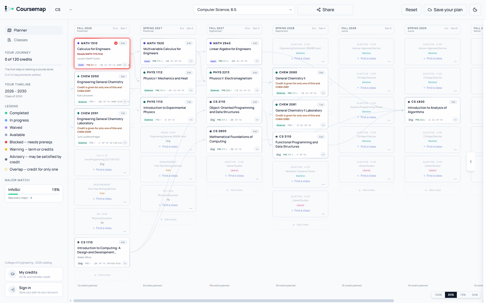
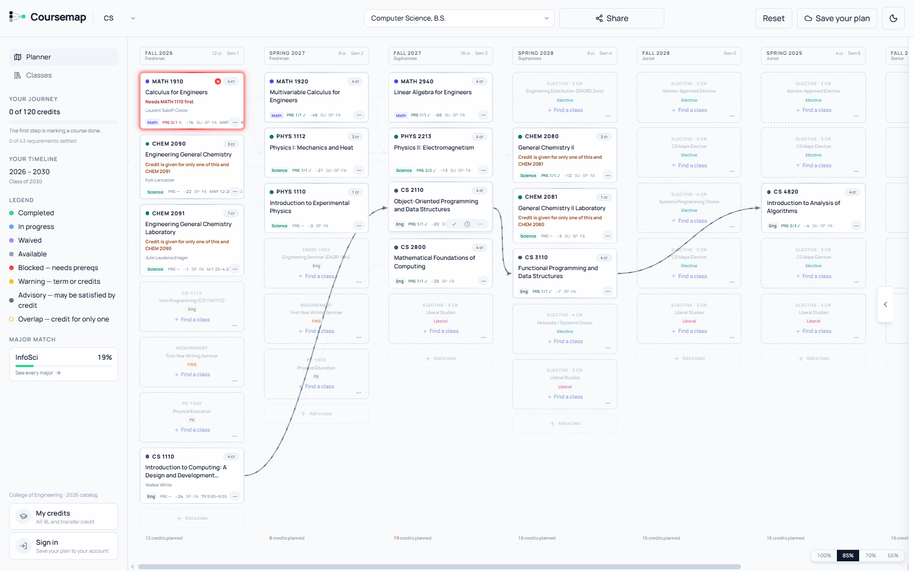
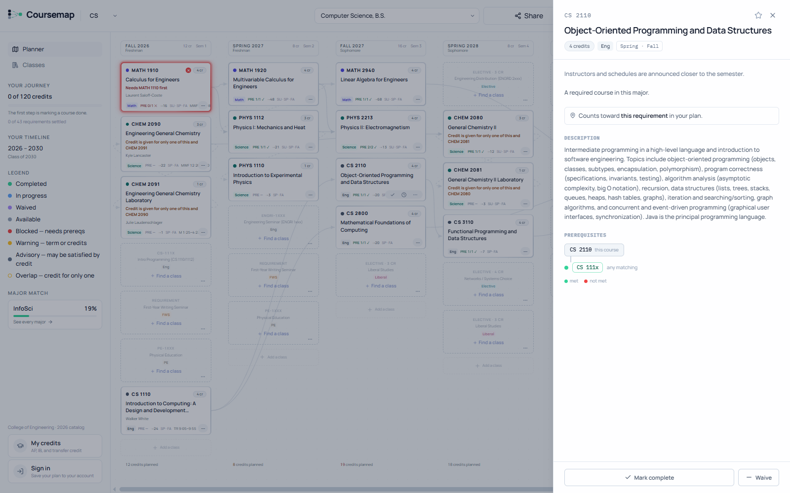
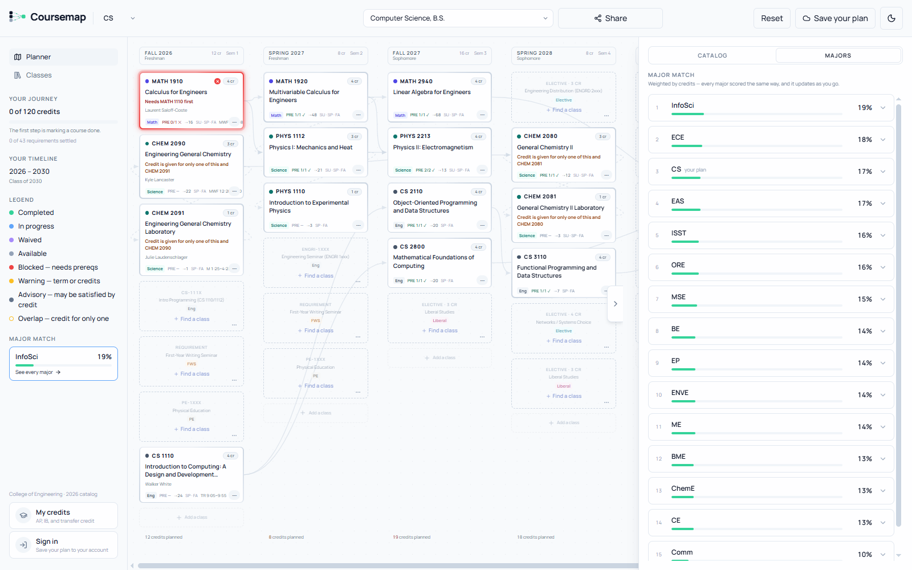
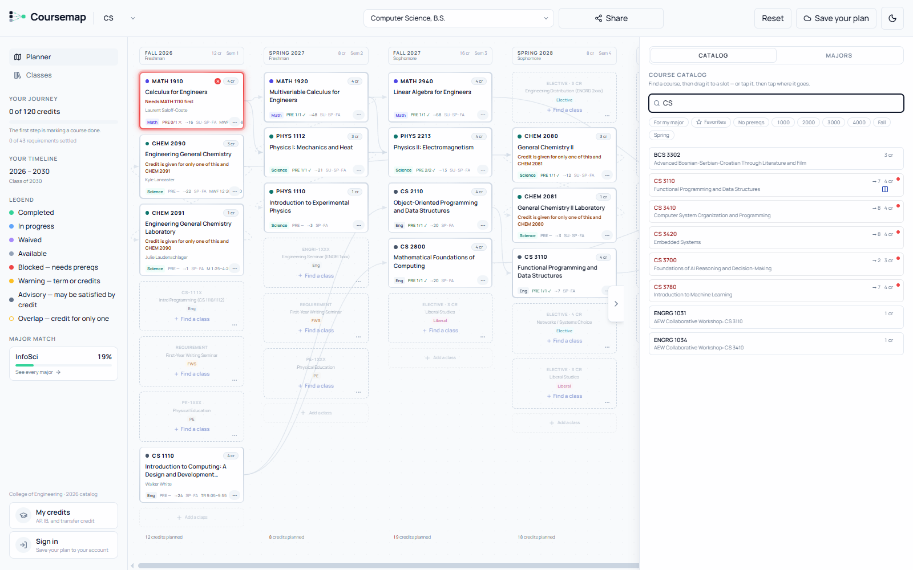
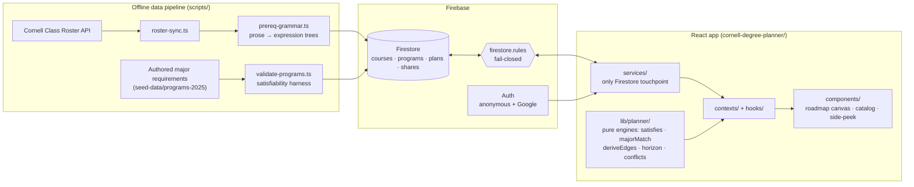

<div align="center">

# Coursemap

**A four-year degree planner for Cornell students, where prerequisites are a live graph instead of a static flowchart.**

[](https://github.com/michaeljtommaso/coursemap/actions/workflows/ci.yml)


[**Live app →**](https://degree-planner-app.web.app) &nbsp;·&nbsp; [Docs & specs](docs/README.md) &nbsp;·&nbsp; [Architecture](#architecture)

</div>

> [!NOTE]
> **This is the public version of the project.** It's generated from my private working repository by a
> [publishing script](#about-this-repository) that keeps the real commit history but leaves out working material:
> day-to-day session notes and handoffs, internal product-planning documents, one third-party data-ingest
> script, and environment config. Everything you see here (the app, the data pipeline, the tests, the specs and
> audits) is the real code and the real record of how it was built.

<picture>
  <source media="(prefers-color-scheme: dark)" srcset="docs/media/hero-dark.png">
  
</picture>

## Why it exists

Cornell publishes each major's requirements as a PDF flowchart and each course's prerequisites as free text.
Students stitch the two together by hand, and the hard question goes unanswered: *"what should I even major in,
given the classes I actually want to take?"* Coursemap turns both sources into data. You plan on a canvas,
the prerequisite graph updates itself as you move courses around, and every major is continuously scored
against what you've picked.

## What it does

- **Plan on a semester canvas.** Drag or click courses into eight semesters. Requirement slots, credit totals and
  term-offered warnings update as you go. Dropping onto a filled slot replaces it, with an undo.
- **See the live prerequisite graph.** Edges are *derived* from each course's parsed prerequisites, not hand-drawn.
  Hover a course to light up the chain behind it and everything it unlocks.
- **Get honest status on every card.** Completed, in progress, waived, available, blocked, wrong term, or
  "advisory" (a prerequisite that may already be satisfied by AP or placement credit).
- **Match majors.** All 15 supported majors are ranked by how well your courses fill each one's requirements,
  with an explanation of which course counts toward what.
- **Trust data by distance.** Next semester's cards show who's teaching, meeting times and schedule conflicts.
  Cards four years out show only data that will still be true then.
- **Use AP, IB and transfer credit.** Synthetic credit courses flow through the same evaluator as real ones.
- **Start without an account.** Plans work anonymously. Signing in with Google saves them, and read-only share links
  publish a snapshot.

| Hover a course: its prerequisite chain and unlocks | Course detail with the prerequisite tree |
|---|---|
|  |  |
| **Major Match: every major, ranked** | **Catalog search with prerequisite status** |
|  |  |

## Engineering highlights

- **A parser for Cornell's prerequisite prose.** [`scripts/prereq-grammar.ts`](scripts/prereq-grammar.ts) turns
  free-text strings ("CS 2110 or equivalent, and MATH 1920 or co-registration…") into typed `PrereqExpr` trees.
  It's deterministic and rule-based. Anything it can't parse confidently is quarantined for review rather than guessed.
  A fixed corpus of real roster strings guards it against regressions.
- **One satisfaction engine.** [`satisfies.ts`](cornell-degree-planner/src/lib/planner/satisfies.ts) is the only place
  that decides "is this satisfied, and by what?". Prerequisites, corequisites and degree requirements all share a single
  tree walk, which removed a whole class of disagreeing-evaluator bugs.
- **Major matching as bipartite assignment.** [`majorMatch.ts`](cornell-degree-planner/src/lib/planner/majorMatch.ts)
  assigns courses to requirement seats with Hopcroft–Karp maximum matching, then fills credit pools by credit weight.
  A course can't be double-counted, and the module has no notion of the student's "current" major, so it can't be
  biased toward one.
- **A graph derived from data, not drawn.** [`deriveEdges.ts`](cornell-degree-planner/src/lib/planner/deriveEdges.ts)
  walks the prerequisite trees of the courses you've placed and emits edges between them. A reverse index powers
  hover-to-see-what-this-unlocks.
- **A data pipeline with teeth.** [`roster-sync.ts`](scripts/roster-sync.ts) ingests Cornell's public Class Roster API
  into Firestore. [`validate-programs.ts`](scripts/validate-programs.ts) evaluates every requirement of every major
  against the full catalog and fails loudly on any requirement no real course can satisfy.
- **Security that fails closed.** [`firestore.rules`](firestore.rules) default-denies and allowlists exact document
  shapes, with self-escalation guards and write caps. A deny-matrix test suite runs against the Firestore emulator.
  A standalone [billing circuit breaker](billing-breaker/) detaches billing if spend ever passes a hard cap.
- **Pure core, thin shell.** All planning logic lives in framework-free, unit-tested modules under
  [`src/lib/planner/`](cornell-degree-planner/src/lib/planner). React components render the results, and a service
  layer is the only code that touches Firestore.

## Architecture



| Layer | Tech |
|---|---|
| Frontend | React 19, TypeScript (strict), Vite, Tailwind with a custom CSS-variable token system, anime.js for motion |
| State | Zustand (planner UI), React context providers (session data), Zod at every read boundary |
| Backend | Firebase: Firestore, Auth (anonymous + Google), Hosting |
| Data pipeline | Node + `tsx` scripts using the Firebase Admin SDK |
| Testing | Vitest (400+ unit tests), corpus suites for the parser and validators, Firestore emulator rules tests, GitHub Actions CI |

## Repository layout

| Path | What's there |
|---|---|
| [`cornell-degree-planner/`](cornell-degree-planner) | The web app |
| [`cornell-degree-planner/src/lib/planner/`](cornell-degree-planner/src/lib/planner) | Pure planning engines and their tests |
| [`scripts/`](scripts) | Roster ingest, prerequisite parser, seeding, validation harnesses and their corpora |
| [`firestore.rules`](firestore.rules) · [`rules-tests/`](rules-tests) | Security rules and their emulator test suite |
| [`billing-breaker/`](billing-breaker) | Cloud Function that hard-caps spend |
| [`docs/`](docs/README.md) | Product and design docs, 13 feature specs, engineering audits |

## Running it locally

The fastest way to try it is the [live app](https://degree-planner-app.web.app). It works without an account.

To run it yourself you'll need Node 20+ and a Firebase project with Firestore and Auth enabled:

```bash
cd cornell-degree-planner
npm ci
cp .env.example .env.local   # fill in your Firebase web config
npm run dev
```

The course catalog is seeded with the scripts in [`scripts/`](scripts). See [`docs/DEPLOY.md`](docs/DEPLOY.md) for the
full runbook.

**Tests** (the same checks CI runs):

```bash
(cd cornell-degree-planner && npm ci && npm run typecheck && npm test)   # app: types + unit tests
(cd scripts && npm ci && npx tsx prereq-grammar.corpus.ts)               # one of the pipeline corpora
(cd rules-tests && npm ci && npm run test:rules)                         # security rules (needs Java for the emulator)
```

## How it was built

Coursemap is built spec-first. Each feature starts as a written spec with explicit decisions, open questions and a
`STATUS:` banner. It's then built in small reviewed units against tests and verified in a real browser before it ships.
The [`docs/`](docs/README.md) folder keeps that trail: 13 specs, the audits that motivated them, and the design
explorations behind the UI.

I built it with **Claude Code as my pair programmer**. I set the product direction and made the design and
architecture calls; those decisions are recorded in each spec. AI agents implemented much of the code in reviewed units,
gated by tests. The `Co-Authored-By: Claude` lines in the history reflect that working style.

## About this repository

My private repo is the working notebook. This public repo is generated from it by a small script
that:

1. keeps only an allowlisted set of paths (code wholesale, docs file by file);
2. redacts a handful of private references from every historical version;
3. scans the entire resulting history against a denylist and refuses to publish if anything matches.

The rewrite is deterministic, so the history above is the real commit-by-commit history, filtered. What's not here:
working session notes, handoffs and the running status log; internal product-planning documents; the ingest script
for a third-party ratings source; environment files; and Cornell's copyrighted flowchart images (linked from
[`docs/reference/flowcharts/`](docs/reference/flowcharts/README.md) instead).

## License

Copyright © 2026 Michael Tommaso. **All rights reserved.** This code is published for viewing and evaluation only. See
[LICENSE](LICENSE).
